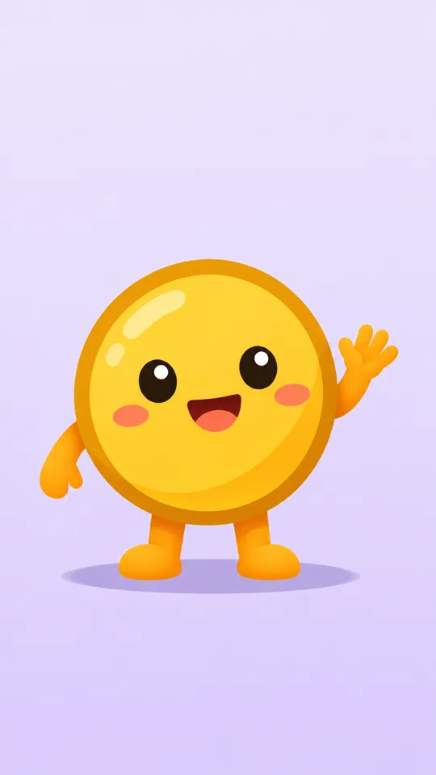

# Codex Image Skill

Cópia integrada à coleção de skills do mwllo.dev. O [repositório original](https://github.com/meninbom/codex-image-skill) permanece independente.

**PT-BR**: Esta skill de agente gera e edita imagens com a ferramenta de imagem embutida do **Codex CLI**. Ela usa o seu login do ChatGPT, então não precisa de chave de API nem de API paga. O agente conduz um briefing adaptativo quando necessário, aplica presets opcionais, gera a imagem, valida o PNG e inspeciona o resultado. Se o pedido já vier completo, não precisa perguntar nada. O consumo sai dos limites de uso do Codex no seu plano.

**EN**: An agent skill that generates and edits images with the **Codex CLI**'s built-in image tool. It runs on your ChatGPT login, so it needs no API key and no paid API. The agent asks only essential questions for vague requests, optionally applies presets and brand kits, validates the PNG, then inspects the result. Usage comes out of your plan's Codex limits.

```bash
python3 skills/codex-image/scripts/codex_image.py "flat vector golden coin mascot, big eyes, lavender #EDE7FF background, no text" \
  -o assets/moedinha.png --aspect 9:16 --crop
python3 skills/codex-image/scripts/codex_image.py "Edit image 1. Change only: add a small green banknote in the hand" \
  --ref assets/moedinha.png -o assets/moedinha-nota.png --aspect 9:16 --crop
python3 skills/codex-image/scripts/codex_image.py --quota
```

## Novidades desta proposta / What's new

- **Briefing adaptativo no agente:** pedido completo gera diretamente; pedido incompleto recebe 1–2 perguntas úteis; edições reutilizam decisões anteriores. O Python não abre diálogos.
- **Presets:** `--preset hero|mascot|social|reel` define orientação e composição-base, sem engessar o estilo. Um `--aspect` explícito prevalece.
- **Mascote para foto de perfil:** `--preset mascot --avatar-safe` faz briefing com foco no rosto central, enquadramento quadrado e prévia circular (`AVATAR_PREVIEW`). Mantém a figura reconhecível após o corte circular do Instagram; o agente ainda precisa conferir visualmente a prévia.
- **Brand kit local:** `--brand-kit caminho/brand.md` incorpora identidade visual do projeto ao prompt, sem rede e sem guardar credenciais.
- **Enquadramento:** `--framing crop` (com `--focal-x/--focal-y`), `--framing contain` ou `--framing blur` preservando o conteúdo. `--crop` continua funcionando como alias. *Contain* e *blur* não são outpainting com IA.
- **QA real:** arquivo PNG íntegro, dimensões verificadas, razão exata quando há enquadramento, transparência efetiva se solicitada. Falha antes de publicar um resultado inválido.
- **Cotas e CI:** snapshots antigos não bloqueiam novas gerações após a renovação; testes automatizados funcionam sem gastar cota Codex.

Exemplos:

```bash
# Direção visual de hero, mantendo toda a imagem sem recorte
python3 skills/codex-image/scripts/codex_image.py \
  "Editorial product hero; laptop to the right, negative space to the left" \
  --preset hero --brand-kit path/to/brand.md --framing contain \
  -o public/hero.png

# Mascote com recorte focal para a direita
python3 skills/codex-image/scripts/codex_image.py \
  "Friendly coin character, full body, clean outlines" \
  --preset mascot --framing crop --focal-x 0.7 \
  -o public/mascot.png

# Avatar quadrado: gera também prévia com o corte circular de perfil
python3 skills/codex-image/scripts/codex_image.py \
  "Mascote simpático para Instagram de educação, rosto expressivo, sem texto" \
  --preset mascot --avatar-safe -o assets/mascote.png

# Testes locais sem chamar Codex
python3 -m unittest discover -s skills/codex-image/tests -v
```

Observação: `--aspect` sem `--framing` apenas orienta o modelo, pois a geração nativa não garante dimensões finais exatas.

## Requisitos / Requirements

- `codex` CLI logged in with ChatGPT (`codex login`) and the `image_generation` feature enabled.
- Python 3.8+ e **Pillow obrigatório** (`pip install pillow`). A validação é feita antes da publicação do arquivo; sem Pillow o comando encerra antes de gerar imagens.

## Layout

```text
skills/codex-image/
  SKILL.md                 instruções para o agente
  README.md                este guia
  LICENSE                  licença original
  scripts/codex_image.py   Codex CLI → image_gen → PNG
  scripts/image_utils.py   presets, framing, quotas e QA
  presets.json             configurações visuais reutilizáveis
  tests/                  testes offline
  examples/                amostras WebP e seus briefings
```

Execute os comandos acima a partir da raiz do repositório `skills`, ou adapte o caminho do script ao local da instalação.

## Exemplos / Examples

| Brief | Result |
|---|---|
| [`examples/moedinha.txt`](examples/moedinha.txt), `--aspect 9:16 --crop` |  |
| [`examples/hero-mwllo.txt`](examples/hero-mwllo.txt), `--aspect 16:9 --crop` (3rd iteration) |  |
| Same hero with the H1 and CTA set in HTML (1440×900) |  |

## Créditos / Credits

The workflow is inspired by [gustavo-henriq/nano-banana-pro-skill](https://github.com/gustavo-henriq/nano-banana-pro-skill) by **gustavo-henriq**: the agent as art director, briefs with numbers, looking before you ship, and quota alerts at 50/25/10/5 %. No code or text was copied. That repository is now "All Rights Reserved" (since 2026-11-16), so this one is an independent implementation built on a different backend.

## License

MIT, see [LICENSE](LICENSE).
